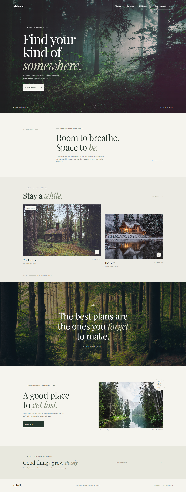

# Stillwild

A thoughtfully designed, responsive landing page for **Stillwild**, a fictional cabin retreat in New York's Catskill Mountains. The page pairs forest photography, expressive typography, and a warm, understated color palette to introduce the cabins and invite visitors to slow down.

The project uses plain HTML, CSS, and JavaScript. There is no build process, framework, package installation, or server-side code required.



## Preview

Open [`index.html`](./index.html) directly in a modern browser, or start a local web server by following the instructions below.

## Run locally

Run these commands from the project directory using PowerShell:

```powershell
python -m http.server 8000
```

Open [http://localhost:8000](http://localhost:8000). Stop the server with `Ctrl+C` when you are finished.

Alternatively, open `index.html` directly in your browser. A local web server is recommended for a more representative preview.

## Project structure

| File | Description |
| --- | --- |
| [`index.html`](./index.html) | Page content, metadata, accessible labels, and external font and image references |
| [`styles.css`](./styles.css) | Design tokens, page layout, responsive styles, hover effects, and reduced-motion support |
| [`script.js`](./script.js) | Mobile navigation and newsletter form interactions |
| [`screenshot.png`](./screenshot.png) | Full-page desktop screenshot of the finished landing page |

## Page sections

- **Hero:** Full-width forest photograph, headline, location, and link to explore the cabins.
- **Introduction:** A short editorial introduction to the retreat.
- **Cabins:** Two featured stays, descriptive details, and starting nightly rates.
- **Quote:** A full-width visual break with a note about slowing down.
- **Field notes:** A photo-led invitation to explore the area.
- **Newsletter:** An email signup form with browser validation and an inline confirmation.
- **Footer:** Wordmark, social link, and copyright notice.

The navigation and calls to action link to sections on the same page. The footer email experience is a **front-end demonstration**, not a connected mailing list: submitting a valid email address displays a confirmation but does not send or store the address.

## Interactions

- On narrow screens, the navigation opens and closes using the menu button. Selecting a navigation link closes the menu.
- Cabin images, links, and buttons include hover treatments; the page also supports smooth in-page navigation.
- The newsletter form requires a valid email address before displaying its confirmation. It does not submit data to a service.

## Responsive design and accessibility

The layout adapts to phone, tablet, and desktop viewport sizes. Images include descriptive alternative text where they convey information; decorative photography is marked as decorative. The mobile navigation announces its expanded state, the email field has a label, and the signup message uses a live region. The stylesheet respects the operating system's reduced-motion preference.

## Assets and external services

Cabin and landscape photographs are served by [Unsplash](https://unsplash.com/). The **DM Sans** and **Playfair Display** typefaces are served by [Google Fonts](https://fonts.google.com/). An internet connection is needed to download these assets. When offline or if an external service is unavailable, the page falls back to system fonts and the browser's image fallback.

## Customization

- Update copy, links, image URLs, and cabin details in `index.html`.
- Adjust the color palette and typography in the CSS custom properties at the top of `styles.css`.
- Replace the example newsletter interaction in `script.js` with an email-marketing provider or your own API to collect subscriptions.
- Replace `screenshot.png` after making design changes if you want the README image to match the latest page.
